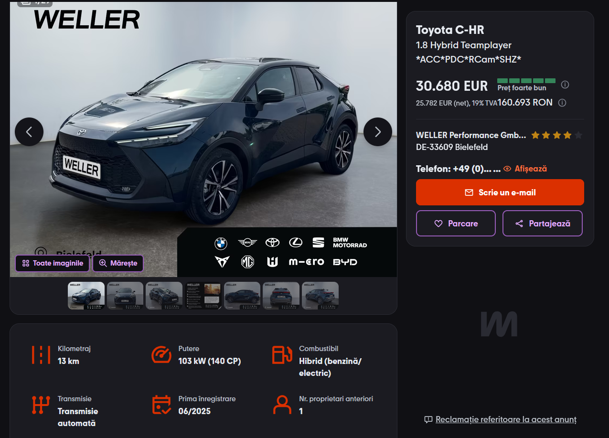
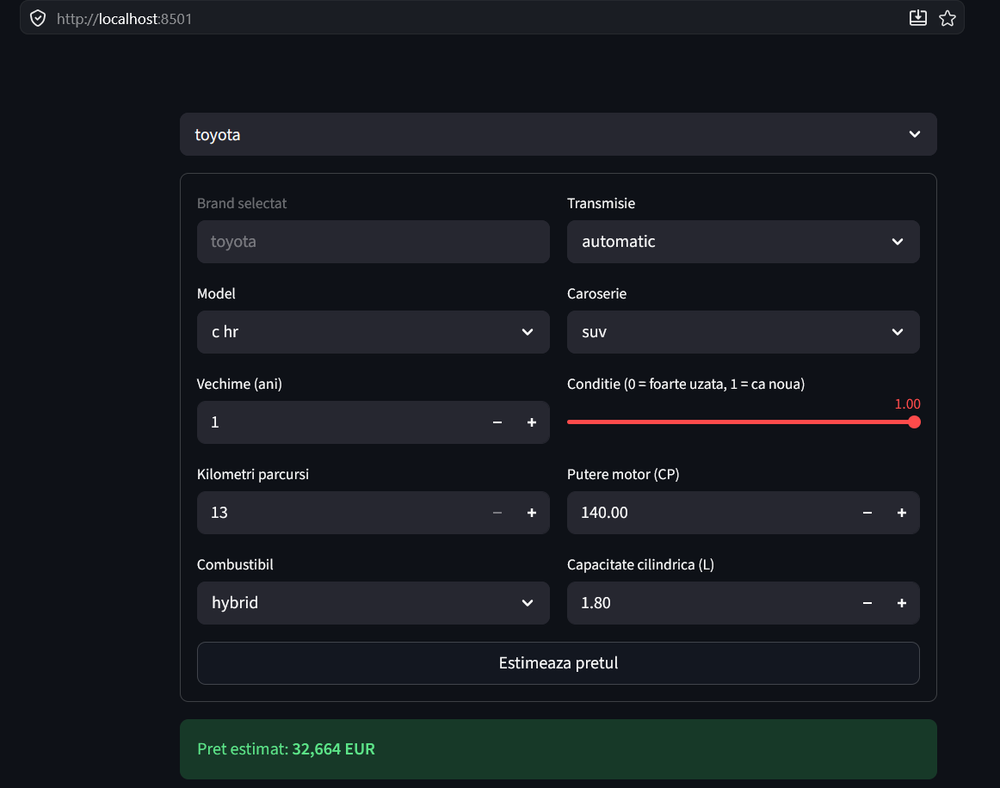
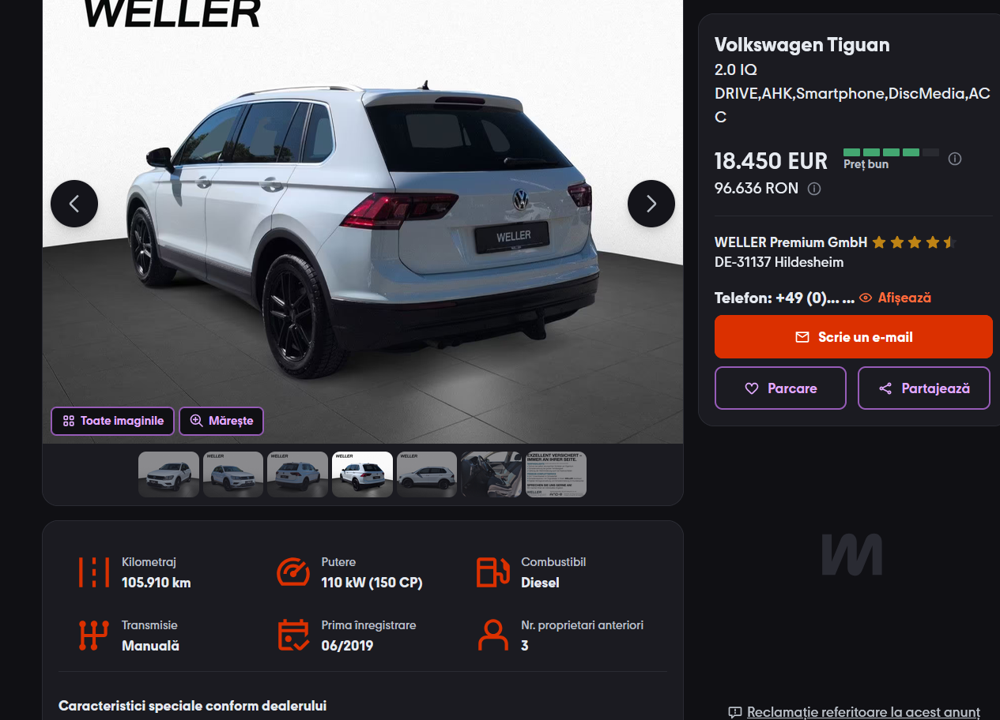
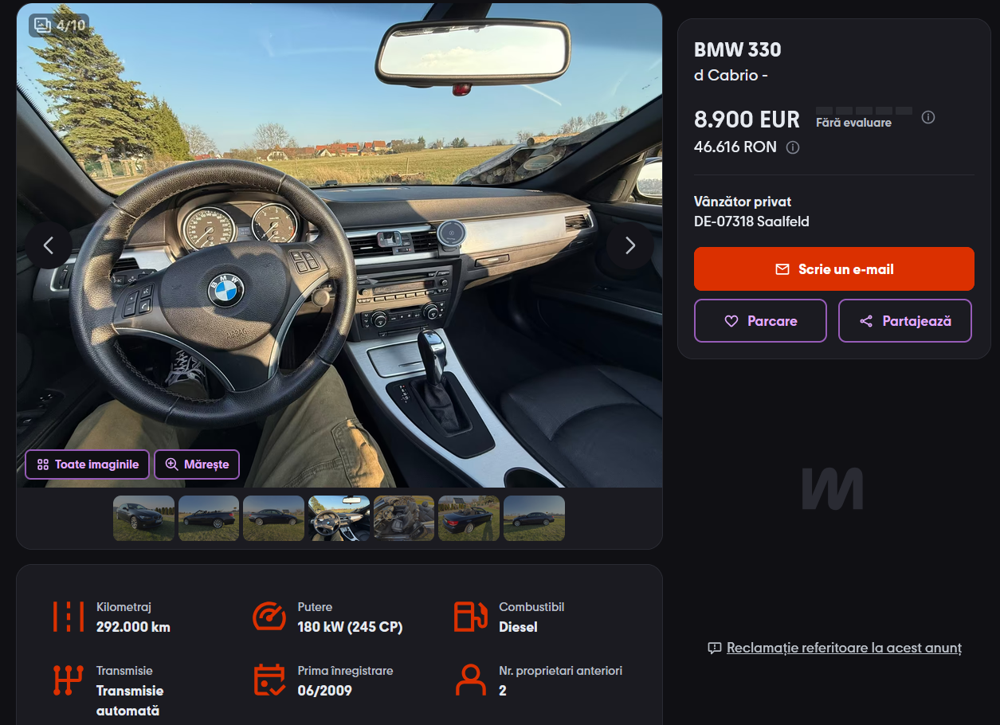
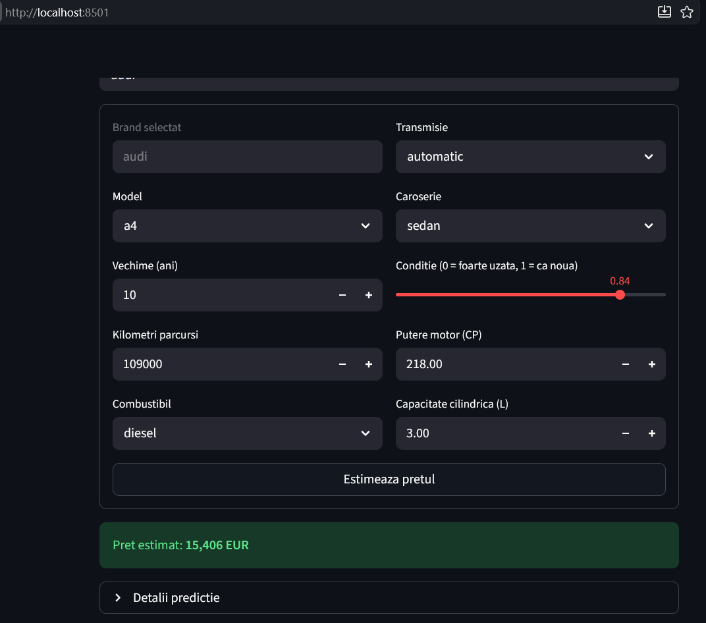
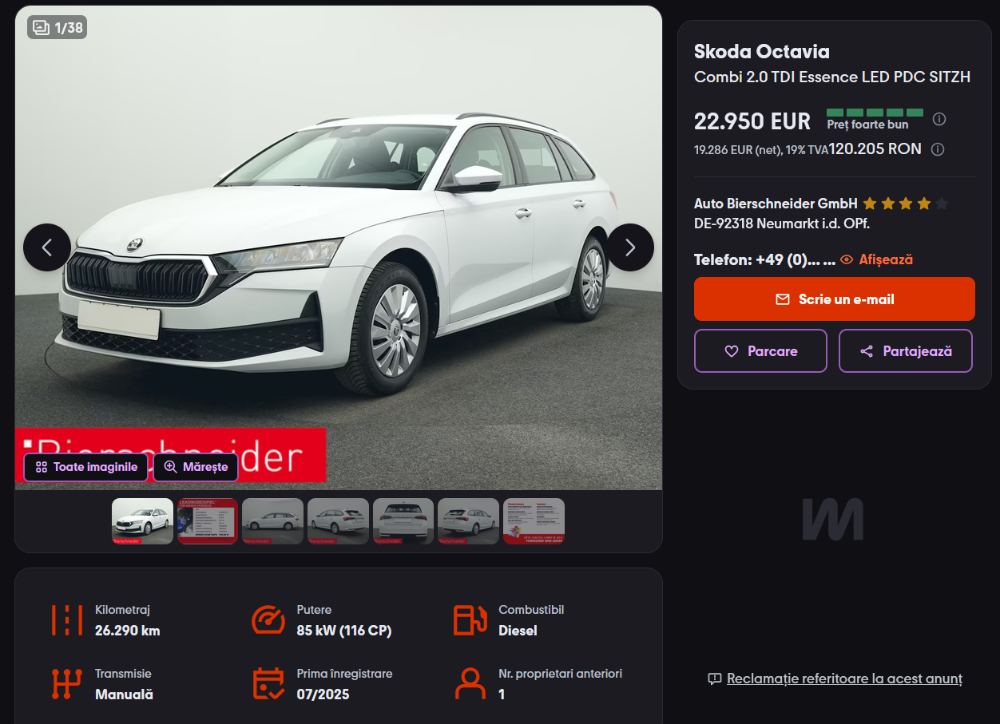

# Car Price Prediction

Proiect de machine learning pentru estimarea pretului masinilor second-hand pe baza unor caracteristici precum brand, model, vechime, kilometraj, combustibil, transmisie, conditie, putere motor, capacitate motor si tip caroserie.

Modelul final foloseste LightGBM, iar hiperparametrii au fost optimizati cu Optuna. Proiectul include si o aplicatie Streamlit simpla pentru testarea predictiilor.

## Rezultate

Model final: LightGBM + Optuna, target transformat cu `log1p(price)`.

Metrici obtinute pe setul de test:

| Metrica | Valoare |
| --- | ---: |
| MAE | 1862.47 |
| RMSE | 4535.58 |
| R2 | 0.8770 |

Cele mai importante feature-uri dupa gain au fost:

1. `age`
2. `km`
3. `model`
4. `transmission`
5. `engine_power`

## Detalii experiment

Setul final folosit pentru antrenare a avut shape-ul:

```text
(843694, 14)
```

Coloanele finale au fost:

```text
brand, model, age, km, fuel, transmission, price, condition,
engine_power, engine_size, body_type, condition_was_missing,
engine_power_was_missing, engine_size_was_missing
```

Pentru modelul final au fost folosite urmatoarele coloane ca input:

```text
brand, model, age, km, fuel, transmission, condition,
engine_power, engine_size, body_type
```

Optuna a rulat 50 de trial-uri si cautarea hiperparametrilor a durat aproximativ `1:49:02`. Cel mai bun trial a obtinut RMSE `0.33917` pe scala logaritmica. Modelul final a fost apoi antrenat cu cei mai buni hiperparametri si a facut early stopping la iteratia `5458`, cu RMSE `0.331176` pe setul de validare folosit in training.

Hiperparametrii gasiti de Optuna:

| Parametru | Valoare |
| --- | ---: |
| learning_rate | 0.06898887361751911 |
| num_leaves | 124 |
| max_depth | 16 |
| min_child_samples | 5 |
| subsample | 0.6398604303362794 |
| colsample_bytree | 0.7955885803428208 |
| reg_alpha | 0.9007367057297124 |
| reg_lambda | 0.18150389687760782 |

## Modele incercate

Inainte de modelul final LightGBM + Optuna au fost testate si alte modele. Rezultatele de mai jos sunt pastrate pentru comparatie:

| Model | MAE | RMSE | Median AE | R2 | MAPE |
| --- | ---: | ---: | ---: | ---: | ---: |
| Random Forest pe log(price) | 2195.00 | 4832.29 | 1005.20 | 0.8522 | 30.98% |
| HistGradientBoosting pe log(price) | 2639.51 | 5350.60 | 1287.05 | 0.8188 | 33.89% |
| Ridge pe log(price) | 3632.17 | 6851.46 | 1972.25 | 0.7029 | 51.44% |
| Dummy median baseline | 8976.87 | 13144.01 | 6524.60 | -0.0933 | 181.27% |
| LightGBM + Optuna | 1862.47 | 4535.58 | - | 0.8770 | - |

LightGBM + Optuna a fost ales ca model final deoarece a obtinut cea mai buna combinatie intre eroare absoluta, RMSE si R2.

## Predictii pe anunturi reale

Aceasta sectiune compara predictiile modelului cu preturi cerute in anunturi reale. Imaginile sunt pastrate in `figures/real_ads/`.

<table>
  <tr>
    <th>Imagine site</th>
    <th>imagine predictie</th>
    <th>Masina</th>
    <th>Pret real</th>
    <th>Predictie model</th>
  </tr>
  <tr>
    <td></td>
    <td></td>
    <td>toyota ch-r</td>
    <td>30.680 EUR</td>
    <td>32.664 EUR</td>
  </tr>
  <tr>
    <td></td>
    <td></td>
    <td>Volkswagen Tiguan</td>
    <td>18.450 EUR</td>
    <td>16.637 EUR</td>
  </tr>
  <tr>
    <td></td>
    <td></td>
    <td>Bmw 3 Series</td>
    <td>8.900 EUR</td>
    <td>9.485 EUR</td>
  </tr>
  <tr>
    <td></td>
    <td></td>
    <td>Audi A4</td>
    <td>18.850 EUR</td>
    <td>15.406 EUR</td>
  </tr>
  <tr>
    <td></td>
    <td></td>
    <td>Mercedes GLC</td>
    <td>29.900 EUR</td>
    <td>24.766 EUR</td>
  </tr>
  <tr>
    <td></td>
    <td></td>
    <td>Skoda Octavia</td>
    <td>22.950 EUR</td>
    <td>19.225 EUR</td>
  </tr>
  
</table>

### Linkuri anunturi

| Link anunt |
| --- |
| [Site Toyota CH-R](https://www.mobile.de/ro/vehicule/detalii.html?id=456921835&sb=rel&od=up&vc=Car&ms=24100&s=Car&ref=srp&searchId=7639ae35-a51d-4abc-fd9b-6c6ef2816c75&refId=7639ae35-a51d-4abc-fd9b-6c6ef2816c75) |
| [Site Volkswagen Tiguan](https://www.mobile.de/ro/vehicule/detalii.html?id=454341738&sb=rel&od=up&vc=Car&ms=25200%3B54&s=Car&ref=srp&searchId=45d4f400-dbb5-a165-1b39-5b669f41c523&refId=45d4f400-dbb5-a165-1b39-5b669f41c523) |
| [Site Bmw 3 Series](https://www.mobile.de/ro/vehicule/detalii.html?id=451139638&sb=rel&od=up&vc=Car&ms=3500%3B%3B21&s=Car&ref=srp&searchId=0de6b3a0-f724-f8be-4f78-d7d4a32b651d&refId=0de6b3a0-f724-f8be-4f78-d7d4a32b651d) |
| [Site Audi A4](https://www.mobile.de/ro/vehicule/detalii.html?id=457689096&sb=rel&od=up&vc=Car&ms=1900%3B9&s=Car&ref=srp&searchId=78153acf-5082-3258-cc5f-a24aa4b07076&refId=78153acf-5082-3258-cc5f-a24aa4b07076) |
| [Site Mercedes GLC](https://www.mobile.de/ro/vehicule/detalii.html?id=426208209&sb=rel&od=up&vc=Car&ms=17200%3B%3B59&s=Car&ref=srp&searchId=dec8c9d8-a34a-fcdd-adaa-1f5b3253843f&refId=dec8c9d8-a34a-fcdd-adaa-1f5b3253843f) |
| [Site Skoda Octavia](https://www.mobile.de/ro/vehicule/detalii.html?id=458635415&sb=rel&od=up&vc=Car&ms=22900%3B10&s=Car&ref=srp&searchId=ca01e498-e13f-c8f9-8ebb-53fef2672e95&refId=ca01e498-e13f-c8f9-8ebb-53fef2672e95) |

## Structura proiectului

```text
.
|-- app/
|   `-- streamlit_app.py
|-- data/
|   |-- raw/
|   `-- processed/
|-- figures/
|   |-- graphs/
|   `-- real_ads/
|-- models/
|-- scripts/
|   |-- 01_prepare_germany_csv.py
|   |-- 02_prepare_maroc_csv.py
|   |-- 03_prepare_uk_csv.py
|   |-- 04_prepare_us_csv.py
|   |-- 05_join_datasets.py
|   |-- 06_clean_datasets.py
|   `-- 07_train_lightgbm_optuna.py
|-- requirements.txt
`-- README.md
```

## Date

Setul final este construit prin combinarea mai multor surse de date auto din Germania, Maroc, UK si US. Datele brute si fisierele procesate nu sunt incluse in repository, deoarece pot fi mari.

Folderele asteptate local:

```text
data/raw/
  germany.csv
  maroc.csv
  craigslist.csv
  UK/
    audi.csv
    bmw.csv
    ford.csv
    hyundai.csv
    merc.csv
    skoda.csv
    toyota.csv
    vauxhall.csv
    vw.csv
```

## Instalare

```bash
python -m venv .venv
.venv\Scripts\activate
pip install -r requirements.txt
```

## Rulare pipeline

Scripturile se ruleaza din radacina proiectului, in ordinea numerotata:

```bash
python scripts/01_prepare_germany_csv.py
python scripts/02_prepare_maroc_csv.py
python scripts/03_prepare_uk_csv.py
python scripts/04_prepare_us_csv.py
python scripts/05_join_datasets.py
python scripts/06_clean_datasets.py
python scripts/07_train_lightgbm_optuna.py
```

Trainingul cu Optuna poate dura mult, in functie de hardware si de numarul de trial-uri.

## Aplicatie Streamlit

Dupa ce exista modelul antrenat in `models/` si datasetul procesat in `data/processed/`, aplicatia se poate porni din radacina proiectului cu:

```bash
py -m streamlit run app/streamlit_app.py
```

Sau, daca terminalul este deja in folderul `app/`:

```bash
py -m streamlit run streamlit_app.py
```

## Artefacte generate

Scriptul de training salveaza:

```text
models/model_lightgbm_optuna_preturi_auto.pkl
models/best_params_optuna.pkl
figures/graphs/lightgbm_optuna_rezultate.png
```

Modelele si datele generate sunt ignorate de Git prin `.gitignore`.

## Limitari

- Dataseturile provin din piete diferite, iar preturile sunt convertite in euro folosind rate hardcodate.
- Anii de referinta pentru calculul vechimii difera intre surse.
- Unele valori pentru `condition`, `engine_power` si `engine_size` sunt imputate sau aproximate.
- Modelul nu include inca o coloana explicita pentru tara/sursa, desi piata poate influenta puternic pretul.
- Predictiile pentru masini foarte noi sau masini de lux, precum Ferrari sau Porsche, tind sa fie mai mici decat preturile reale. Cel mai probabil, aceste cazuri sunt mai slab reprezentate in datele de antrenare, iar modelul invata mai bine zona masinilor comune decat extremele pietei.
- Pipeline-ul actual este organizat ca scripturi secventiale, nu ca pachet Python reutilizabil.

## Imbunatatiri viitoare

- Adaugarea unor date mai recente, mai ales pentru masini noi si modele premium/lux.
- Colectarea mai multor exemple pentru branduri si modele rare, astfel incat modelul sa invete mai bine segmentul de pret ridicat.
- Adaugarea unei coloane pentru tara sau piata de provenienta a anuntului.
- Testarea modelului pe un set separat de anunturi reale colectate manual.

## Tehnologii

- Python
- pandas, NumPy
- scikit-learn
- LightGBM
- Optuna
- Streamlit
- Matplotlib
