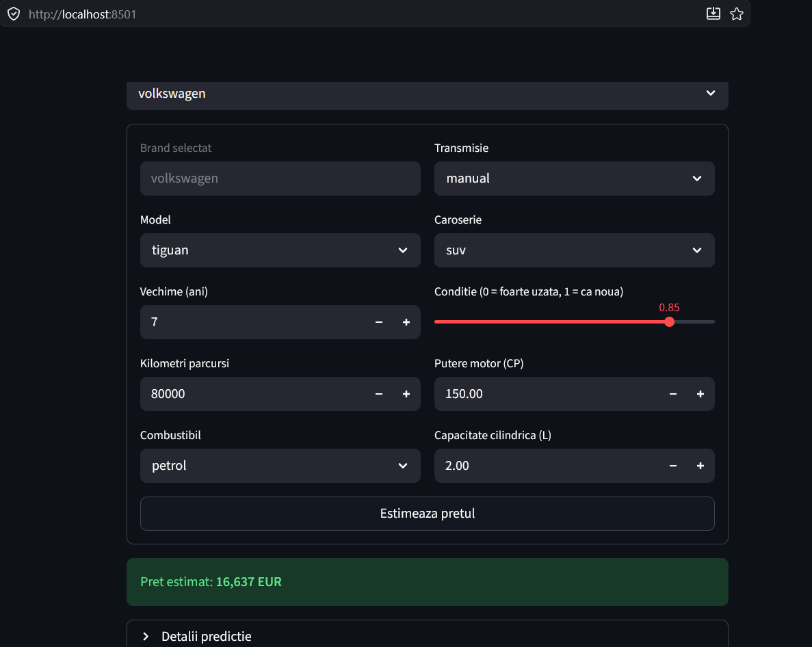
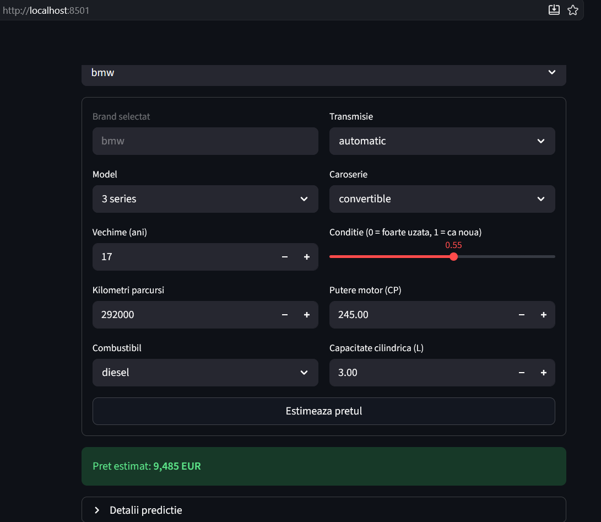
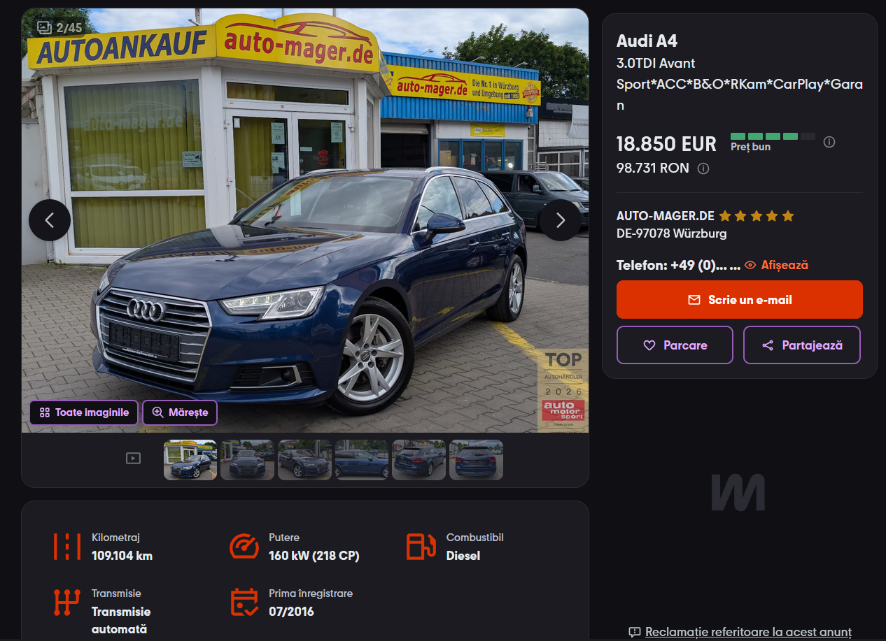
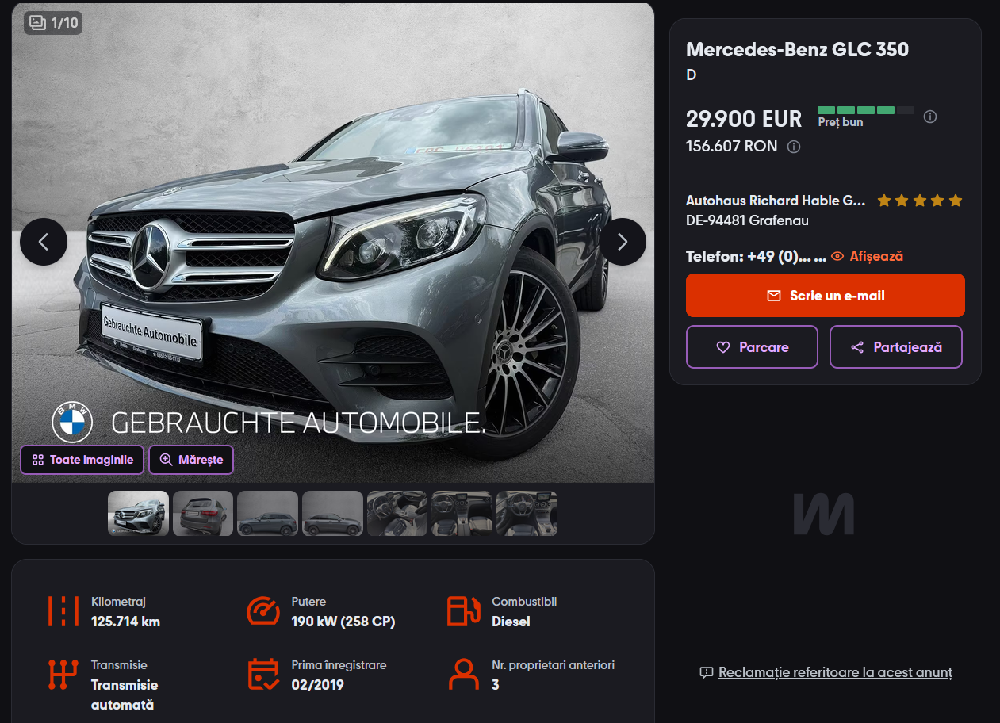
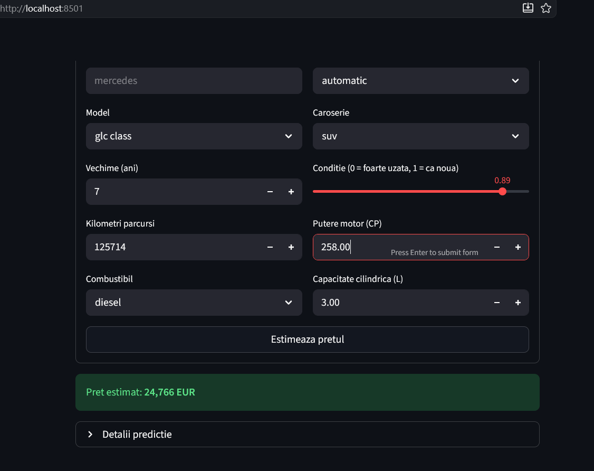
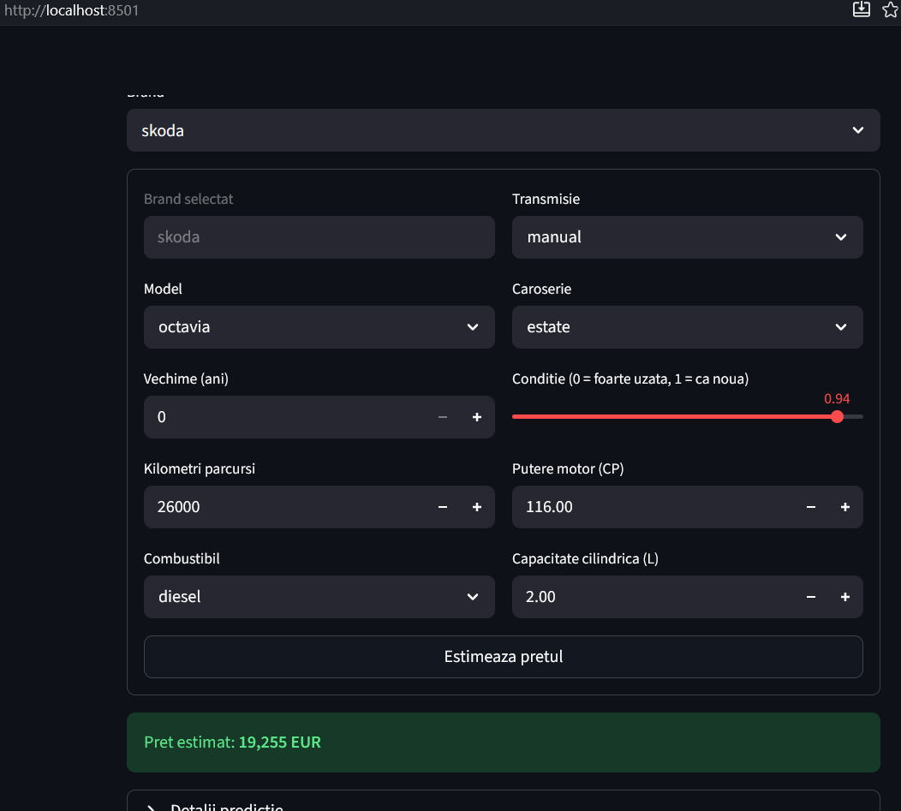

# Car Price Prediction

A machine learning project that estimates used car prices from features such as brand, model, age, mileage, fuel, transmission, condition, engine power, engine size and body type.

The final model is LightGBM with hyperparameters tuned by Optuna. The project also includes a small Streamlit app for trying out predictions.

## Results

Final model: LightGBM + Optuna, with the target transformed as `log1p(price)`.

Metrics on the test set (prices in EUR):

| Metric | Value |
| --- | ---: |
| MAE | 1862.47 |
| RMSE | 4535.58 |
| R2 | 0.8770 |

The most important features by gain were:

1. `age`
2. `km`
3. `model`
4. `transmission`
5. `engine_power`

## Experiment details

The final training set had the shape:

```text
(843694, 14)
```

The final columns were:

```text
brand, model, age, km, fuel, transmission, price, condition,
engine_power, engine_size, body_type, condition_was_missing,
engine_power_was_missing, engine_size_was_missing
```

The final model used these columns as input:

```text
brand, model, age, km, fuel, transmission, condition,
engine_power, engine_size, body_type
```

Optuna ran 50 trials and the hyperparameter search took about `1:49:02`. The best trial reached an RMSE of `0.33917` on the log scale. The final model was then trained with the best hyperparameters and stopped early at iteration `5458`, with an RMSE of `0.331176` on the validation set used during training.

Hyperparameters found by Optuna:

| Parameter | Value |
| --- | ---: |
| learning_rate | 0.06898887361751911 |
| num_leaves | 124 |
| max_depth | 16 |
| min_child_samples | 5 |
| subsample | 0.6398604303362794 |
| colsample_bytree | 0.7955885803428208 |
| reg_alpha | 0.9007367057297124 |
| reg_lambda | 0.18150389687760782 |

## Models tried

Other models were tested before the final LightGBM + Optuna model. Their results are kept below for comparison:

| Model | MAE | RMSE | Median AE | R2 | MAPE |
| --- | ---: | ---: | ---: | ---: | ---: |
| Random Forest on log(price) | 2195.00 | 4832.29 | 1005.20 | 0.8522 | 30.98% |
| HistGradientBoosting on log(price) | 2639.51 | 5350.60 | 1287.05 | 0.8188 | 33.89% |
| Ridge on log(price) | 3632.17 | 6851.46 | 1972.25 | 0.7029 | 51.44% |
| Dummy median baseline | 8976.87 | 13144.01 | 6524.60 | -0.0933 | 181.27% |
| LightGBM + Optuna | 1862.47 | 4535.58 | - | 0.8770 | - |

LightGBM + Optuna was chosen as the final model because it had the best combination of absolute error, RMSE and R2.

## Predictions on real listings

This section compares the model's predictions with asking prices from real listings. The images are kept in `figures/real_ads/`.

<table>
  <tr>
    <th>Listing</th>
    <th>Prediction</th>
    <th>Car</th>
    <th>Asking price</th>
    <th>Model prediction</th>
  </tr>
  <tr>
    <td></td>
    <td></td>
    <td>Toyota C-HR</td>
    <td>30,680 EUR</td>
    <td>32,664 EUR</td>
  </tr>
  <tr>
    <td></td>
    <td></td>
    <td>Volkswagen Tiguan</td>
    <td>18,450 EUR</td>
    <td>16,637 EUR</td>
  </tr>
  <tr>
    <td></td>
    <td></td>
    <td>BMW 3 Series</td>
    <td>8,900 EUR</td>
    <td>9,485 EUR</td>
  </tr>
  <tr>
    <td></td>
    <td></td>
    <td>Audi A4</td>
    <td>18,850 EUR</td>
    <td>15,406 EUR</td>
  </tr>
  <tr>
    <td></td>
    <td></td>
    <td>Mercedes GLC</td>
    <td>29,900 EUR</td>
    <td>24,766 EUR</td>
  </tr>
  <tr>
    <td></td>
    <td></td>
    <td>Skoda Octavia</td>
    <td>22,950 EUR</td>
    <td>19,225 EUR</td>
  </tr>
</table>

### Listing links

| Listing |
| --- |
| [Toyota C-HR](https://www.mobile.de/ro/vehicule/detalii.html?id=456921835&sb=rel&od=up&vc=Car&ms=24100&s=Car&ref=srp&searchId=7639ae35-a51d-4abc-fd9b-6c6ef2816c75&refId=7639ae35-a51d-4abc-fd9b-6c6ef2816c75) |
| [Volkswagen Tiguan](https://www.mobile.de/ro/vehicule/detalii.html?id=454341738&sb=rel&od=up&vc=Car&ms=25200%3B54&s=Car&ref=srp&searchId=45d4f400-dbb5-a165-1b39-5b669f41c523&refId=45d4f400-dbb5-a165-1b39-5b669f41c523) |
| [BMW 3 Series](https://www.mobile.de/ro/vehicule/detalii.html?id=451139638&sb=rel&od=up&vc=Car&ms=3500%3B%3B21&s=Car&ref=srp&searchId=0de6b3a0-f724-f8be-4f78-d7d4a32b651d&refId=0de6b3a0-f724-f8be-4f78-d7d4a32b651d) |
| [Audi A4](https://www.mobile.de/ro/vehicule/detalii.html?id=457689096&sb=rel&od=up&vc=Car&ms=1900%3B9&s=Car&ref=srp&searchId=78153acf-5082-3258-cc5f-a24aa4b07076&refId=78153acf-5082-3258-cc5f-a24aa4b07076) |
| [Mercedes GLC](https://www.mobile.de/ro/vehicule/detalii.html?id=426208209&sb=rel&od=up&vc=Car&ms=17200%3B%3B59&s=Car&ref=srp&searchId=dec8c9d8-a34a-fcdd-adaa-1f5b3253843f&refId=dec8c9d8-a34a-fcdd-adaa-1f5b3253843f) |
| [Skoda Octavia](https://www.mobile.de/ro/vehicule/detalii.html?id=458635415&sb=rel&od=up&vc=Car&ms=22900%3B10&s=Car&ref=srp&searchId=ca01e498-e13f-c8f9-8ebb-53fef2672e95&refId=ca01e498-e13f-c8f9-8ebb-53fef2672e95) |

Listings expire, so some of these links may no longer open.

## Project structure

```text
.
|-- app/
|   `-- streamlit_app.py
|-- data/
|   |-- raw/
|   `-- processed/
|-- figures/
|   |-- graphs/
|   `-- real_ads/
|-- models/
|-- scripts/
|   |-- 01_prepare_germany_csv.py
|   |-- 02_prepare_maroc_csv.py
|   |-- 03_prepare_uk_csv.py
|   |-- 04_prepare_us_csv.py
|   |-- 05_join_datasets.py
|   |-- 06_clean_datasets.py
|   `-- 07_train_lightgbm_optuna.py
|-- requirements.txt
`-- README.md
```

## Data

The final dataset combines several car listing sources from Germany, Morocco, the UK and the US. The raw and processed files are not included in the repository because of their size.

Folders expected locally:

```text
data/raw/
  germany.csv
  maroc.csv
  craigslist.csv
  UK/
    audi.csv
    bmw.csv
    ford.csv
    hyundai.csv
    merc.csv
    skoda.csv
    toyota.csv
    vauxhall.csv
    vw.csv
```

## Installation

```bash
python -m venv .venv
.venv\Scripts\activate
pip install -r requirements.txt
```

## Running the pipeline

Run the scripts from the project root, in numbered order:

```bash
python scripts/01_prepare_germany_csv.py
python scripts/02_prepare_maroc_csv.py
python scripts/03_prepare_uk_csv.py
python scripts/04_prepare_us_csv.py
python scripts/05_join_datasets.py
python scripts/06_clean_datasets.py
python scripts/07_train_lightgbm_optuna.py
```

Training with Optuna can take a long time, depending on hardware and the number of trials.

## Streamlit app

Once the trained model exists in `models/` and the processed dataset in `data/processed/`, start the app from the project root:

```bash
py -m streamlit run app/streamlit_app.py
```

Or, if the terminal is already in the `app/` folder:

```bash
py -m streamlit run streamlit_app.py
```

## Generated artifacts

The training script saves:

```text
models/model_lightgbm_optuna_preturi_auto.pkl
models/best_params_optuna.pkl
figures/graphs/lightgbm_optuna_rezultate.png
```

Generated models and data are ignored by Git through `.gitignore`.

## Limitations

- The datasets come from different markets, and prices are converted to euros with hardcoded rates.
- The reference year used to compute age differs between sources.
- Some values for `condition`, `engine_power` and `engine_size` are imputed or approximated.
- The model has no explicit column for country or source, although the market can strongly influence price.
- Predictions for very new cars and luxury cars, such as Ferrari or Porsche, tend to be lower than real prices. These cases are most likely under-represented in the training data, so the model learns common cars better than the extremes of the market.
- The pipeline is organised as sequential scripts, not as a reusable Python package.

## Future improvements

- Add more recent data, especially for new cars and premium or luxury models.
- Collect more examples of rare brands and models so the model learns the high-price segment better.
- Add a column for the country or market the listing comes from.
- Test the model on a separate set of real listings collected by hand.

## Tech stack

- Python
- pandas, NumPy
- scikit-learn
- LightGBM
- Optuna
- Streamlit
- Matplotlib
